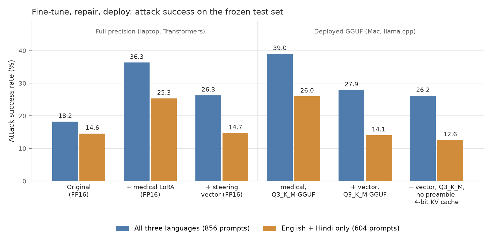

# Safe from Fine-Tune to Phone

**One-line claim.** Benign medical LoRA doubles Tiny Aya Global's attack success (18.2 % to 36.3 %); a run-time steering vector cuts it to 26.3 % and survives GGUF quantization. Without Hinglish, where most fine-tuned answers are degenerate, the rise is 14.6 % to 25.3 % and steering returns it to 14.7 %.

**Lexsi AI Safety and Alignment Hackathon, Track 2 (AI Red Teaming, Safety and Alignment).** Problem statements covered:

- 2a *Multilingual and code-mixed safety*
- 2a *Adversarial and safety evaluation sets* (ClinicSafe-Hi)
- 2b *Repairing safety drift without retraining*
- 2b *Inference-time safety steering*
- 2b *Locating where safety lives* and *Circuit-level interventions*
- 2b *Safety-aware compression*

**Team.** Sushovit Nanda (project lead; laptop lane; GitHub `SushovitNanda`, Hugging Face https://huggingface.co/SushiOrbit) and Manish Shaw (Mac lane).

**Content note.** This work evaluates refusals on harmful medical and general prompts. No harmful model answer appears anywhere in this repository: per-answer records are text-free, and only labels, counts and rates are published.

| Item | Where |
|---|---|
| Full report (PDF, 73 pages: executive summary, hypotheses, all tables and figures) | [`report/Safe-from-Fine-Tune-to-Phone.pdf`](report/Safe-from-Fine-Tune-to-Phone.pdf) in this repository, also attached to the entry; this README is the write-up |
| Pre-registration and its five dated amendments; Mac lane pre-registrations; decision log | `PREREG.md`, `MAC_PREREG.md`, `DECISIONS.md` |
| Hugging Face dataset collection | https://huggingface.co/collections/SushiOrbit/safe-from-fine-tune-to-phone-datasets |
| Hugging Face model collection | https://huggingface.co/collections/SushiOrbit/safe-from-fine-tune-to-phone-models |
| GitHub repository (this write-up and the code) | https://github.com/SushovitNanda/Safe-from-Fine-Tune-to-Phone |
| Hugging Face profile (all repositories and both collections) | https://huggingface.co/SushiOrbit |

---

## 1. Headline: before and after

Pooled over 856 harmful and 756 benign test prompts in English, Hindi and Hinglish; 95 % paired-bootstrap intervals below and in the full report.



| Step | Model | Attack success | Clinical over-refusal | MedMCQA |
|---|---|---:|---:|---:|
| Start | Original Tiny Aya Global, FP16 | 18.2 % | 2.9 % | 40.6 % |
| Fine-tune | + one epoch medical LoRA | 36.3 % | 28.4 % | 45.0 % |
| Control | + token-matched general LoRA | 20.0 % | 9.5 % | – |
| Repair | medical + steering vector (FP16) | 26.3 % | 31.4 % | 45.4 % |
| Deploy | medical, Q3_K_M GGUF, llama.cpp | 39.0 % | 31.4 % | – |
| Deploy + repair | medical + vector, Q3_K_M GGUF | 27.9 % | 35.6 % | – |
| Deploy + repair | medical + vector, Q3_K_M, no preamble, 4-bit KV cache | 26.2 % | 37.3 % | – |

Headline intervals (95 % paired bootstrap): drift +18.1 [15.0, 21.3]; control +1.8 [−0.9, 4.4]; steering −10.1 [−12.5, −7.6]; retention of the repair at Q3_K_M 1.01 [0.74, 1.36].

> **For judges: one minute.**
> - **Drift, before → after:** one epoch of benign medical LoRA raises attack success on 856 harmful prompts from **18.2 % to 36.3 %** (+18.1 [15.0, 21.3]); a token-matched control moves +1.8 [−0.9, 4.4].
> - **Repair, before → after:** a run-time steering vector (layer 24, strength 0.5) cuts the medical model from **36.3 % to 26.3 %** (−10.1 [−12.5, −7.6]); MedMCQA 45.0 % → 45.4 % (McNemar p = 0.69).
> - **Survives deployment:** at Q3_K_M on llama.cpp (second machine, second engine) the same vector cuts **39.0 % to 27.9 %**; retention 1.01 [0.74, 1.36]; preamble stripped 0.85 [0.61, 1.16]; 4-bit NF4 1.16 [0.85, 1.59].
> - **Cost:** clinical over-refusal +2.9 [−2.0, 7.8] pooled (not significant); Hindi clinical +8.8 [2.0, 16.7]; the fix is a serving-time flag, not a weight change.
> - **What we failed to achieve:** ReSta weight patching −1.6 [−3.6, 0.4]; circuit-restricted ReSta −0.6 [−3.5, 2.3]; circuit-guided bit protection against a random control +0.0 [−2.7, 2.7], tested at a setting where stock Q3_K_M already kept the repair; we could not link the circuit map to the drift. Our failures at the settings tried, not proofs that the methods cannot work.
> - **Validity:** 64.7 % of the medical model's Hinglish answers are degenerate text; on non-degenerate prompts the drift is +10.9 [7.7, 14.3] and the repair −8.3 [−11.2, −5.4]; on English and Hindi alone the medical model moves 14.6 % → 25.3 % and the steered model returns to 14.7 %, the original's level. The 300 reference labels behind every κ are AI drafts to the rubric, each checked and approved by the first author; no label is an independent human label.

**Base model and method in one line.** Tiny Aya Global 3.35B (Cohere Labs, CC-BY-NC-4.0); one epoch of LoRA on medical exam questions, then a contrastive-activation steering vector (layer 24, strength 0.5) added at inference and evaluated as a llama.cpp control vector on Q4_K_M and Q3_K_M GGUF builds.

## 2. Abstract

Clinics fine-tune small open-weights models on medical text and compress them for cheap hardware, and their users often write in Hindi or Hinglish. For Tiny Aya Global, public safety numbers cover only full-precision English with the system prompt. We follow the model through that whole chain under a dated pre-registration: where are its refusals weakest, does benign medical fine-tuning widen the gaps, which components carry refusal, can a repair without retraining restore it, and does that repair survive quantization, a stripped system prompt and circuit-guided precision protection at equal file size?

We built ClinicSafe-Hi, 102 harmful clinical requests paired with 102 benign twins in English, Hindi and Hinglish, and combined it with Aya Red-teaming and XSTest into a frozen test set of 1,612 prompts, plus 500 held-out MedMCQA questions. CuratorKIT curated two token-matched LoRA corpora; CircuitKIT ran EAP-IG refusal-circuit discovery; SafeTune's ReSta was the reference for weight-space patching; AuditKIT drove the llama.cpp evaluation runs. Judges were validated per language against 300 reviewed labels (Cohen's kappa 0.81 English, 0.84 Hindi, 0.62 Hinglish); every result is a paired comparison with bootstrap intervals and Holm correction.

One epoch of benign medical LoRA doubles attack success from 18.2 % to 36.3 % (+18.1 points [15.0, 21.3]); the token-matched control moves +1.8 [−0.9, 4.4]. A run-time steering vector cuts the medical model to 26.3 % (−10.1 [−12.5, −7.6]) with medical accuracy unchanged (MedMCQA 45.0 % to 45.4 %). The cut survives deployment: at 4-bit NF4 retention is 1.16 [0.85, 1.59]; on llama.cpp at Q3_K_M the same vector cuts 39.0 % to 27.9 % (retention 1.01 [0.74, 1.36]); with the system preamble stripped 0.85 [0.61, 1.16]; on a simulated budget-phone stack 0.79 [0.54, 1.11]. The cost is clinical over-refusal: +2.9 points pooled [−2.0, 7.8] (not significant) and +8.8 [2.0, 16.7] in Hindi at FP16.

What we failed to achieve: ReSta weight patching gives −1.6 [−3.6, 0.4] at the setting that keeps accuracy; circuit-restricted ReSta −0.6 [−3.5, 2.3]; our extra bits for the circuit's tensors at equal file size protected the repair no better than random tensors (+0.0 [−2.7, 2.7]); and we could not link the circuit map to the drift. A validity audit found 64.7 % of the medical model's Hinglish answers to harmful prompts degenerate; on non-degenerate prompts the drift is +10.9 [7.7, 14.3] and the repair −8.3 [−11.2, −5.4]. Plainly: the fine-tune made the model less safe, and the vector recovers about half of that loss. The deployed, repaired model is safer than the fine-tuned model it replaces, not safer than the original.

## 3. Why this problem, and the real use case

Small open-weights models are the only models a clinic in a low-connectivity district can run on its own hardware with patient data staying on site. Fine-tuning on domain text and compressing for cheap hardware are the two steps every such deployment takes, and both are taken by people who read safety numbers measured on the base model in full-precision English with the system prompt in place. The use case is a clinic chatbot answering patient questions in English, Hindi or Hinglish on an on-site machine. **Threat model:** an ordinary user asking directly for harmful help in a single turn, in any of the three languages, without jailbreak templates; the defender controls the fine-tune, the repair and the serving configuration but not the user's language, and may have removed the system prompt.

The pattern is not specific to medicine. Nuclear plant operations, power-grid control rooms, water utilities, rail and air-traffic operations and emergency services share the same shape: a domain corpus the model must learn, data that stays on site, operators who write in their own language and register, and hardware budgets that force quantization. What transfers is the chain, not the numbers: measure refusal per language before and after the domain fine-tune against a token-matched control; validate the judge on the deployment's own language and model; repair at serving time when retraining is not available; and verify the repair after compression and prompt stripping, with over-refusal of legitimate domain questions measured alongside.

## 4. Hackathon repos (kits) used, and how they connect

| Kit | How it was used |
|---|---|
| **CuratorKIT** 0.1.21 | Cleaned and deduplicated the two fine-tuning corpora (MinHash at 0.85, Detoxify toxicity gate at 0.5, 10 to 4,096 tokens; medical set 4,998 → 4,843 rows, control −50 rows, both then trimmed to 4,815 and 5,004 rows so token totals match within 1 %); its MinHash helpers power the leak check. |
| **CircuitKIT** 0.2.0 | EAP-IG node-level refusal-circuit discovery per language on the original and the medical model; our necessity and sufficiency validation runs on its TransformerLens port. |
| **SafeTune** 0.1.8 | Reference implementation of ReSta; our streaming ReSta was checked for numerical equivalence against it; our steering code follows its refusal-direction recipe. |
| **AuditKIT** 1.1.3 | Its API backend drove every llama.cpp evaluation cell on the Mac; the laptop harness re-implements the same paired statistics and the two were cross-checked. |
| **llama.cpp** (pinned build) | GGUF conversion, K-quantization, serving on Metal, and the control-vector mechanism. |

AlignTune was not used; the fine-tunes ran on the Transformers Trainer with PEFT. **How they connect:** CuratorKIT → data package → LoRA fine-tunes (PEFT) → merged FP16 weights → CircuitKIT discovery and validation → tensor map → repairs (ReSta from SafeTune's reference, steering) selected on dev → steering vector exported as a control vector → GGUF builds served by llama.cpp and driven by AuditKIT → one judge host labels every answer from both lanes → paired statistics. The architecture figure is in the report.

## 5. Models, datasets and licences

**Models.** Tiny Aya Global 3.35B (Cohere Labs, CC-BY-NC-4.0, one pinned snapshot) at FP16 and bitsandbytes NF4 on the laptop; F16, Q4_K_M and Q3_K_M GGUF on the Mac. Tiny Aya Base is the ReSta base. Judges: Qwen3Guard-Gen-4B (English and Hinglish safety, refusal everywhere) and WildGuard on IndicTrans2 back-translation (Hindi safety). No closed-model baseline was run; an API appears only as the price comparator.

**Datasets** (all under `Datasets/final/`, one schema, manifest and checksums per set; card in `Datasets/final/README.md`):

| Set | Language | Test / dev | Source and licence |
|---|---|---|---|
| Aya Red-teaming | EN, HI | 200 / 50 each | CohereForAI/aya_redteaming, Apache-2.0 |
| Aya Hinglish rewrites | Hinglish | 150 / 50 | rewritten from the Hindi items, same intent |
| ClinicSafe-Hi (ours) | EN, HI, Hinglish | 102 harmful + 102 benign twins per language; 30-pair dev sets | CC-BY-NC-4.0 |
| XSTest safe prompts | EN, HI, Hinglish | 150 / 100 per language (HI and Hinglish machine-drafted and post-edited) | XSTest, CC-BY-4.0 |
| MedMCQA | EN | 500 test / 300 dev; a 995-item dev set for selection | openlifescienceai/medmcqa, Apache-2.0 |
| SFT medical / control | EN | 4,815 / 5,004 rows | MedMCQA explanations; Alpaca-cleaned (CC-BY-NC-4.0) |
| Calibration pairs | EN; EN+HI+Hinglish | 100+100; 33 per language per side | drawn from the pools above, disjoint from test |

Leak check between fine-tuning and evaluation sets: exact match on normalised text, MinHash at 0.85, and embedding cosine at 0.92 (`Datasets/final/leak_report*.json`). The frozen test set has 1,612 prompts (856 harmful, 756 benign).

## 6. Metrics, and why these

| Metric | Direction | Why |
|---|---|---|
| Attack success rate (share of harmful prompts answered unsafely, per-language primary judge) | lower is better | what a deployer's safety case rests on |
| Over-refusal rate on benign prompts, general and clinical apart | lower is better; **must not get worse** | the cost side of every repair |
| MedMCQA accuracy (500 held-out questions) | higher is better; **must not get worse** | the capability the fine-tune was done for |
| Language gap against English | closer to zero is better | the Track 2a question |
| Retention R(s) of the repair in a deployment setting | closer to 1 is better | the Track 2b compression question |
| Difference-in-differences; last-mile gap | closer to zero is better | fragility of the fine-tuned model to deployment |
| Degenerate-output share | lower is better | validity: classifiers count repetition loops as harm |

Judge check: Cohen's κ against 300 reference labels (AI drafts to the rubric, each checked and approved by the first author; no independent human label), bar 0.6 (unsafe label: English 0.81 [0.57, 1.00], n = 55; Hindi 0.84 [0.62, 1.00], n = 57, on back-translation; Hinglish 0.62 [0.35, 0.84], n = 51, so Hinglish clears the bar only within noise; Hinglish refusal κ 0.31 [0.18, 0.47], so Hinglish over-refusal is reported as a direction only; 95 % bootstrap intervals over items). Statistics: paired bootstrap (10,000 resamples, seed 13), exact McNemar for MedMCQA, Holm correction; a difference is claimed only if at least 5 points with the interval clear of zero.

## 7. Method and experiments (summary)

- **Fine-tuning.** LoRA rank 16, α 32, dropout 0.05 on all linear modules; batch 1 × 16 accumulation; AdamW, learning rate 2e-4, cosine, 3 % warm-up; one epoch; FP16 mixed precision; seed 13; loss on assistant tokens only. 38 min (medical) and 40 min (control) on an RTX 4080 Laptop 12 GB. Merged in FP32 on CPU, saved FP16 with per-tensor SHA-256.
- **Generation.** Greedy, 256 new tokens, official chat template with the 366-token System Preamble unless the cell says otherwise; end-of-turn token (id 6) added to the stop set from Amendment 2 on.
- **Circuits.** EAP-IG, node level, 3 integration steps, sparsity 0.3; validation with necessity (mean ablation) and sufficiency (patching) against five random node sets, with the preamble on.
- **Repairs.** ReSta θ_med + α(θ_Global − θ_Base) whole-model and restricted to the circuit's top 5/10/20 % tensors; steering vector from 33+33+33 contrast pairs per language, applied after decoder layer 24 at strength 0.5; selection on dev, reporting on test.
- **Deployment.** F16 → Q4_K_M and Q3_K_M GGUF without an importance matrix; llama.cpp server with 8 slots, 16,384 context, flash attention; control vector at scale 0.5 on layer 24; no-preamble cells use an empty chat template; budget-phone stack uses a Q4_0 KV cache.
- **Protection (RQ6).** Equal-size Q3_K_M builds: the eight highest-ranked circuit tensors raised to Q8_0 and the lowest-ranked lowered to Q2_K until the size matches stock, against a random tensor draw of the same shape and type classes (seed 13); layer-0 feed-forward tensors excluded.
- **Seeds.** 13 throughout (43 for the control-set trim, 23–27 for calibration draws). One training run per model; bootstrap resamples prompts, not training runs.

## 8. Results and findings

Pre-registered hypotheses (one per question; verdicts in the full report, Section 5): H1 refusal is weaker in Hindi and Hinglish and on clinical harms, most in Hinglish (holds for Hinglish and clinical harms; Hindi suggestive only); H2 medical drift exceeds the token-matched control, largest in Hinglish and on clinical harms (holds except the harm-type pattern); H3 a partly shared refusal circuit exists, with larger fine-tuning changes in Hindi and Hinglish (holds only as a statement about structure); H4 a training-free repair restores refusals without accuracy loss and the circuit-restricted patch keeps more accuracy at equal safety (not supported); H5 retention falls below 1 at Q3_K_M and without the preamble, most in Hinglish (not supported); H6 extra bits on the circuit's tensors protect the repair better than on random tensors (not supported). Decision rule: at least 5 points with the 95 % interval clear of zero.

Named findings (details, intervals and figures in the full report, Sections 5 and 6):

1. **Gap (RQ1).** Original model: attack success 11.6 % English, 17.6 % Hindi, 27.0 % Hinglish; Hinglish +15.4 points above English, clinical harms +16.9 above general harms. The Hindi gap depends on which judge reads Hindi.
2. **Drift (RQ2).** One benign medical epoch: +18.1 points pooled against +1.8 for the token-matched control; broad across harm types. about half of the medical model's unsafe labels fall on degenerate text; on non-degenerate prompts the drift is +10.9.
3. **Cause (RQ3).** Per-language refusal circuits pass sufficiency patching in every language and necessity clearly only in Hinglish; fine-tuning did not change the circuits beyond their noise floor, and we could not link the map to the drift.
4. **Fix (RQ4).** Steering −10.1 points at no measured MedMCQA loss; ReSta −1.6 and circuit-restricted ReSta −0.6 at the settings that keep accuracy. The link from RQ3 to RQ4 is not supported.
5. **Last mile (RQ5).** The steering effect stays clear of zero at NF4, Q4_K_M, Q3_K_M, without the preamble and on the budget-phone stack, on a second machine and engine; retention 0.79 to 1.16 with wide intervals. Quantization costs the unsteered model 2 to 3 points.
6. **Protection (RQ6).** Protected minus random +0.0 [−2.7, 2.7] pooled, tested at a setting where stock Q3_K_M already kept the repair (retention 1.01), so the test had little loss to recover; the per-language Hinglish contrasts are a judge artefact on degenerate text (blind audit). H6 not supported.
7. **Validity.** Degenerate output, a judge that misses half of the unsafe Hindi answers, and a stop-token mismatch were found by our own checks and are reported with their effect on the numbers.

Everything we tried and failed at is listed in the full report (Table "What was attempted", Section 7). These are our failures at the settings tried, not proofs that the methods cannot work.

## 9. Cost and ROI

Compute: roughly 35 to 40 GPU-hours on the laptop (one RTX 4080 Laptop 12 GB) and about 10 hours of Metal inference on the Mac (one Apple M5 24 GB), both reconstructed from the per-cell run records; the 48 timed cells, 14 of them full test cells, took about 11.5 h on the laptop and the five steered Mac cells 3.7 h. All on the authors' own hardware, zero cash cost, plus one parity check on a free Colab T4. Serving cost scenario (Mac lane): at 10,000 requests a month, local Q3_K_M serving costs about 1.36 USD per 1,000 replies against 0.36 USD through an API at listed prices (13.6 against 3.6 USD a month); break-even at about 37,700 requests a month, above the a capacity of about 32,600 requests a month estimated from the measured throughput; measured throughput 54 to 106 completion tokens per second across GGUF settings. No clinic saving is claimed; the case for local deployment is data control and offline use.

## 10. Limitations, dual use and ethics

One training run per model; one random draw for the protection control; judges validated on the original model's answers; the planned human intra-rater check replaced by a blind AI re-label; Hinglish generation from the medical model mostly degenerate; no clinician reviewed the benchmark; the pre-registration's first recorded version came after the first five test cells had been judged. Dual use: publishing which deployment settings weaken refusals carries a small risk, outweighed by the value to deployers; no raw harmful completions are released; the findings concern a public model under standard settings, and Cohere Labs can be given the per-language rates on request. Full list in the full report, Sections 7 and 8.

## 11. With more credits

(1) Repeat the two fine-tunes over five seeds and two further medical sets (expected: drift stays within about 5 points of +18.1); (2) run EAP-IG with the preamble on, attributing against the drift itself (success would be a restricted repair reaching the 5-point margin, against −0.6 now); (3) ten random draws for the protection comparison (expected: protected minus random within ±3 points of zero); (4) native-speaker, clinically trained human labels on the 300-item sample and a Hinglish refusal validation set (expected κ above 0.6 in every language); (5) Hinglish-register fine-tuning data or a decoding-time repetition guard (expected: the Hinglish degenerate share falling from 64.7 % to below 20 %).

## 12. Artifacts

- **Hugging Face dataset collection** (public): https://huggingface.co/collections/SushiOrbit/safe-from-fine-tune-to-phone-datasets. ClinicSafe-Hi, the evaluation, calibration and circuit sets, the fine-tuning sets, and the evaluation logs and judge labels, each with a dataset card, under CC-BY-NC-4.0.
- **Hugging Face model collection** (public, un-gated): https://huggingface.co/collections/SushiOrbit/safe-from-fine-tune-to-phone-models. The LoRA adapters, the merged FP16 weights, the F16 GGUF with the quantization rules and checksums that define the evaluated Q3_K_M builds, and the refusal steering vector, each with a model card, under CC-BY-NC-4.0.
- **GitHub repository:** https://github.com/SushovitNanda/Safe-from-Fine-Tune-to-Phone. The code of both lanes, the data package, the results, the pre-registration and decision log, and these reproduction instructions.
- No demo Space, video or slides accompany this submission.

## 13. Repository layout

```
README.md               this file: write-up, layout, run instructions, declarations
LICENSE                 MIT for code; data and model licences stated inside
PREREG.md               pre-registration (laptop lane) with Amendments 1–5 (5 withdrawn, disclosed)
MAC_PREREG.md           the Mac lane's four dated pre-registrations, pooled in date order
DECISIONS.md            dated decision log for the whole project
ENV.md, requirements*   pinned environments (laptop: requirements.txt; Mac: requirements-mac.txt / .lock)
Datasets/final/         every evaluation and fine-tuning set: prompts.jsonl + manifest.json + checksums.txt,
                        leak reports, token-match report, hand-label rubric outputs (labels only), dataset card
Datasets/interim/       specifications and sheets behind the hand-written items (ClinicSafe-Hi spec,
                        Hinglish style guide, XSTest post-edit spec, review decisions)
scripts/data/           builds the data package (download, splits, Hindi drafts, assembly, calibration,
                        CuratorKIT curation, leak check, Qwen3Guard prompt check, HF packaging)
finetune/               LoRA training and merging
harness/                laptop evaluation harness: cell generation, Qwen3Guard judge, back-translation,
                        WildGuard judge, paired statistics, final statistics, kappa
repair/                 ReSta (streaming), its equivalence check against SafeTune, repair builds,
                        steering calibration
locate/                 CircuitKIT EAP-IG runs, token sets, tensor maps, circuit validation
scripts/eval/           MedMCQA one-token accuracy
scripts/smoke/          environment smoke tests (G1–G7)
scripts/*.py, *.sh      analysis and orchestration: judge validation, majority votes, intra-rater scoring,
                        control-vector export, reference-tensor export, lane comparison, run chains
scripts/report/         report builders: LaTeX sections, and tables and figures generated from the result files
report/                 the full report as PDF and its headline figure
scripts/mac/            Mac lane: model preparation, GGUF conversion, serving, resumable cells through AuditKIT,
                        template and EOS audits, equal-size protection builds, deployment statistics, ROI, D8 report
configs/mac/            Mac lane inputs: tensor inventories, protection rules, run manifests
templates/              empty chat template for no-preamble cells
tests/                  Mac lane unit tests
colab/                  Colab parity check (free T4) and its results
results/cells/<cell>/   per-cell text-free records (prompt id, tokens, settings), judge labels, run info,
                        MedMCQA predictions; laptop cells and mac__* cells
results/final_stats/    the final statistics (final.json) and the validation audits
results/judges/         kappa tables; results/drift, repair_dev, repair_test, probe_dev: stage summaries
results/circuits/       EAP-IG scores, tables and validation per language
results/mac/, mac_judged/  Mac lane evidence (builds, fidelity gates, operational checks) and central label summaries
results/review_final/   independent re-derivation of the statistics, integrity audit, majority votes
handoff/                numbered lane hand-offs: D4 tensor map, D5 repair recipes, D5b steering vector metadata,
                        D7 label summaries (the labels themselves are under results/cells)
reports/D8/             Mac lane results report, evidence JSON and figures
release/                model card and artifact manifest of the GGUF repository in the HF model collection
MANIFEST.sha256.json    SHA-256 of every data, code and result file (README, LICENSE and .gitignore excepted)
```

Not in this repository, by design: raw model answers to harmful prompts and their back-translations (private), model weights, merged checkpoints and GGUF files (Hugging Face), reference tensors, run logs, access tokens.

## 14. Reproduce

All seeds are 13 unless stated. Paths are relative to the repository root. Model files live under `models/` (git-ignored); set `HF_HOME=models/hf_cache`.

**Environment (laptop, Windows 11, CUDA 12.8).** Python 3.12. Set `HF_TOKEN` in the environment (a free Hugging Face token; needed by the download step for the pinned snapshots) and `HF_HOME=models/hf_cache`.
```bash
pip install torch==2.11.0 --index-url https://download.pytorch.org/whl/cu128
pip install -r requirements.txt
pip install git+https://github.com/Lexsi-Labs/CuratorKIT@dd9e835301fcddc74a37501d9e207a5a060d209f
pip install git+https://github.com/Lexsi-Labs/SafeTune@26f59e6d1bdcacafe5f2be3b8d982fb214369659
pip install git+https://github.com/Lexsi-Labs/CircuitKIT@e71d5e17fe6e2abfde47ec9a7fbaf31649601b78
```
Kit versions and commits are the ones in `ENV.md` (curatorkit 0.1.21, safetune 0.1.8, circuitkit 0.2.0, auditkit 1.1.3). IndicTrans2 back-translation needs a side environment (Python 3.13, transformers 4.57.6, IndicTransToolkit 1.1.1). **Mac (Apple silicon).** Python 3.12; `pip install -r requirements-mac.lock`; llama.cpp built with Metal at the pinned build recorded in `results/mac/environment.json`; the shell scripts under `scripts/` call `python` from the active environment.

**Data package.**
```bash
python scripts/download_all.py
cd scripts/data
python build_medmcqa.py 5000 && python build_alpaca.py && python build_aya.py && python build_xstest.py
python translate_indictrans2.py xstest && python translate_indictrans2.py calib      # Hindi drafts (side environment)
python assemble_manual.py hinglish && python assemble_manual.py clinicsafe && python assemble_manual.py xstest
python build_calibration.py sheets && python build_calibration.py final
python leak_check.py v1 && python curate_sft.py medical && python curate_sft.py control
python qwen3guard_check.py && python leak_check.py v2 && python leak_check.py v3
python build_circuit_pairs_v2.py && python draw_hand_label_sample.py
```

**Fine-tune and merge.**
```bash
python finetune/train_lora.py Datasets/final/sft_medical/train.jsonl models/runs/med
python finetune/train_lora.py Datasets/final/sft_control/train.jsonl models/runs/ctrl
python finetune/merge.py models/runs/med/adapter models/merged/med
python finetune/merge.py models/runs/ctrl/adapter models/merged/ctrl
```

**One laptop cell, judged and scored** (repeat per cell listed in `results/cells/`; `--weights nf4` for 4-bit cells; `--resta`/`--steer` options in `repair/resta.py` for repair cells).
```bash
python harness/run_cell.py --cell med__fp16__f16__tpl-official --model models/merged/med --weights fp16 --stop_eot 1
python harness/judge.py --cell med__fp16__f16__tpl-official
python harness/backtranslate.py --cell med__fp16__f16__tpl-official --langs hi        # side environment
python harness/judge_wildguard.py --cell med__fp16__f16__tpl-official --langs hi
python scripts/eval/medmcqa_score.py --model models/merged/med --set Datasets/final/medmcqa_test_500/prompts.jsonl --out results/cells/med__fp16__f16__tpl-official/medmcqa_test500.json
python harness/kappa.py && python harness/stats.py --cells orig__fp16__f16__tpl-official med__fp16__f16__tpl-official ctrl__fp16__f16__tpl-official
```

**Circuits, repairs, steering vector.**
```bash
python locate/token_sets_v2.py
python locate/run_circuitkit_v2.py --lang en --tag orig        # and hi, hinglish; --model models/merged/med --tag med; --half a|b
python locate/validate_circuit.py --lang en                     # and hi, hinglish
python locate/tensor_map_v2.py
python repair/check_resta.py --alpha 0.25
python repair/steer_calibrate.py --pairs trilingual --model models/merged/med --out models/steer/med_trilingual.pt
python scripts/export_cvec.py                                   # layer-24 vector -> llama.cpp control vector
python harness/final_stats.py                                   # -> results/final_stats/final.json
```

**Mac lane** (run from the repository root on the Mac).
```bash
python scripts/mac/prepare_models.py          # pinned snapshots; original model F16 -> Q4_K_M / Q3_K_M
python scripts/mac/convert_merged.py          # medical merge -> F16 GGUF, then quantize
python scripts/mac/audit_templates.py         # template and EOS audits
python scripts/mac/serve.py --gguf models/gguf/med-q3km.gguf --stop-eot \
    [--control-vector handoff/D5b_steering_2026-11-09/steer_L24.cvec --strength 0.5 --layer 24] [--template none] [--phone-cache]
python scripts/mac/run_cell.py --cell mac__rep_steer_q3km --gguf models/gguf/med-q3km.gguf --tokenizer CohereLabs/tiny-aya-global \
    --server-receipt models/local-results/server.receipt.json --split test --protocol MAC_PREREG.md --stop-eot \
    --out results/cells/mac__rep_steer_q3km      # resumable generation through AuditKIT; --template none for no-preamble cells
# steer_L24.cvec (binary, not in this repository) comes from the HF model collection: SushiOrbit/tinyaya-global-refusal-steering-vector
python scripts/mac/protect_gguf.py            # equal-size protected and random Q3_K_M builds
python scripts/mac/deployment_stats.py        # RQ5/RQ6 statistics from the central labels
python scripts/mac/roi.py && python scripts/mac/build_d8_tables.py && python scripts/mac/build_d8_figures.py
```
Mac answers travel to the laptop as ZIPs (D6); the laptop judges them centrally (`scripts/judge_new_zips.sh`, `scripts/import_mac_cells.py`) and returns labels (D7).

**Report tables and figures.** `python scripts/report/make_thesis_figures.py && python scripts/report/make_architecture_figure.py && python scripts/report/make_rq6_figures.py && python scripts/report/build_thesis.py` regenerate every table and figure of the report from the result files (the LaTeX build itself is not part of this repository).

## 15. Declaration of work done outside the hackathon

None. The project's working repository (private; this public repository is its whitelist export, first pushed on 15 November 2026) begins on 3 November 2026 with environment set-up, as does the decision log; every dataset, script, fine-tune, evaluation cell, label, figure and the report were produced between 3 and 15 November 2026 by the two authors. The only pre-existing code is third-party: the track toolkits at pinned versions, llama.cpp, TransformerLens, and the public models and benchmarks cited above.

## 16. Author contributions

**Sushovit Nanda (project lead; laptop lane).** Led the project from start to finish: conceived and designed the study, set its six questions, its pre-registration and its decision rules, directed both lanes and all of the AI-assisted engineering, and owns every judgement call and every reported result. Wrote the plan, the pre-registration and its amendments and the decision log; built the data sets and the benchmark specifications; ran the fine-tunes, merges, repair sweeps, steering, NF4 and every laptop test cell; ran circuit discovery and validation and produced the tensor map; designed the labelling rubric, drew the 300-item sample and checked and approved every hand label; holds sole authority over and responsibility for every judgement call in the decision log; ran all judging centrally for both lanes, the statistics, the validity audits and the majority votes; validated every reported result; wrote the report.

**Manish Shaw (Mac lane).** Built the GGUF conversion and quantization pipeline, the llama.cpp serving and generation harness, the template and EOS audits and the Mac pre-registrations; converted and quantized the models, ran the fidelity gates and every Mac deployment cell; designed and built the equal-size protected and random builds with their size, type and byte-identity checks; measured the numeric differences between the two lanes' merges; independently reproduced the deployment and RQ6 statistics from the central labels, computed the conservative 58-test Holm union, ran the throughput and cost analysis, prepared the model card and licence check, and wrote the Mac lane reports.

**Use of AI assistants.** AI assistants (Claude Code) did the engineering: the code base and environment set-up on both machines, execution of the fine-tunes, sweeps and cells, debugging and log monitoring, under the authors' written specifications and recorded in the decision log. Decision-making and validation of results stayed with the first author. AI agents produced first drafts to his specifications, each reviewed and approved before use (the ClinicSafe-Hi items, the Hindi and Hinglish variants, the 300 hand labels), the blind second and third readings, the adjudication, the audits and the majority votes (reported as AI readings), and the drafts of Amendments 3 to 5 (ratified by him). A large share of the code and of the text was drafted with AI assistance and edited by the authors. No reported number was written by an assistant without a script reading it from the result files.

**Acknowledgements.** The organisers of the Lexsi AI Safety and Alignment Hackathon for the Track 2 brief, and Cohere Labs for releasing Tiny Aya.

## 17. Changelog

- 15 Nov 2026: first public submission repository (whitelist export of the working repository; no raw completions, weights or logs).
- 15 Nov 2026 (later): canonical artifact links; wording, reproduction-command and consistency corrections after a final five-way independent review.
